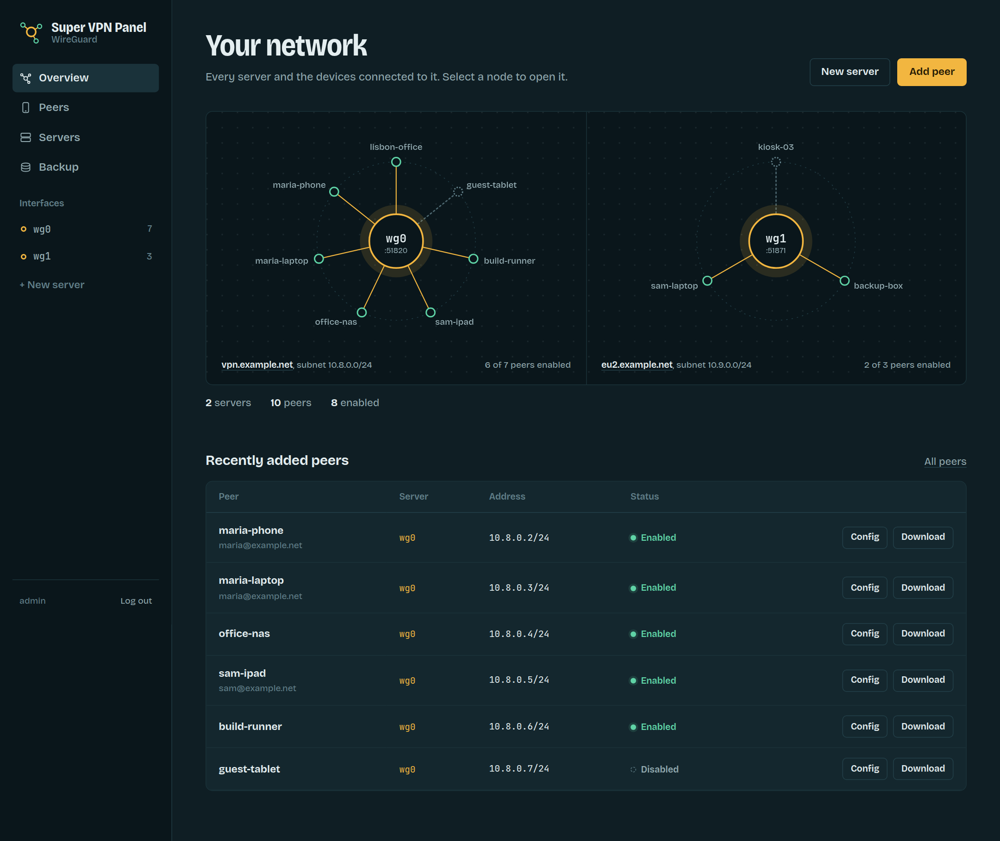
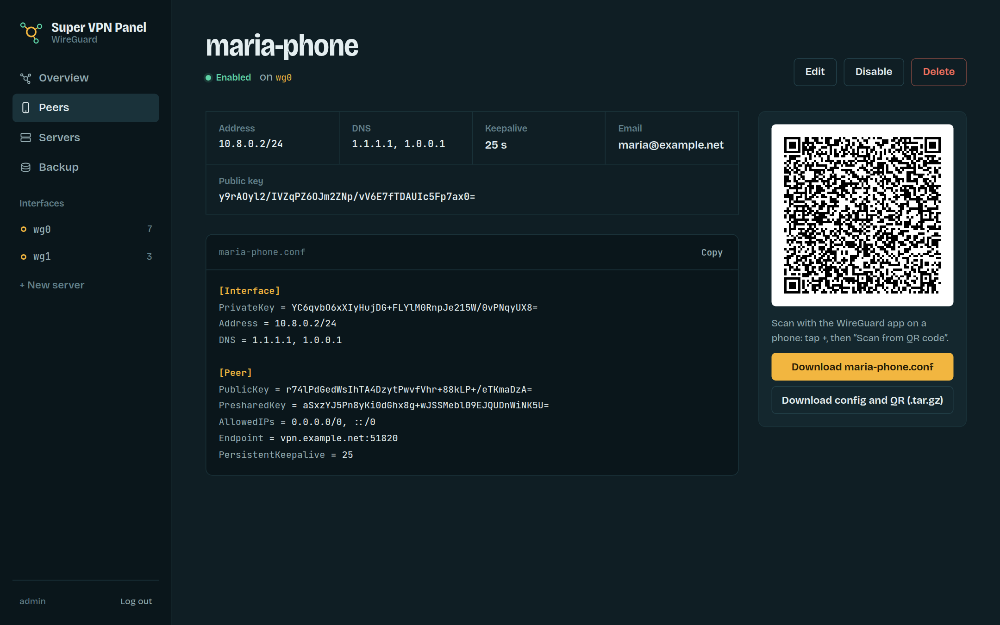
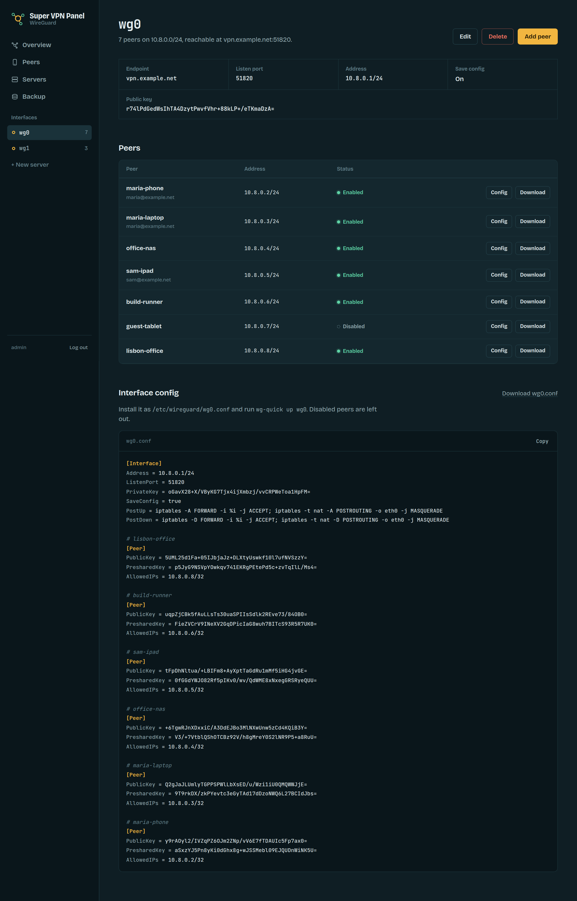
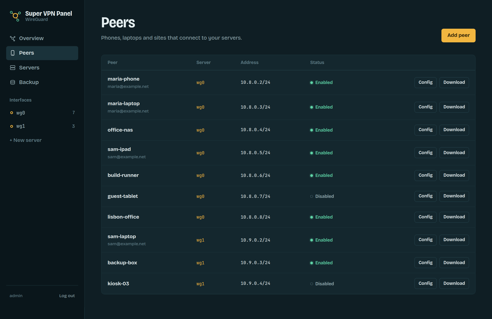
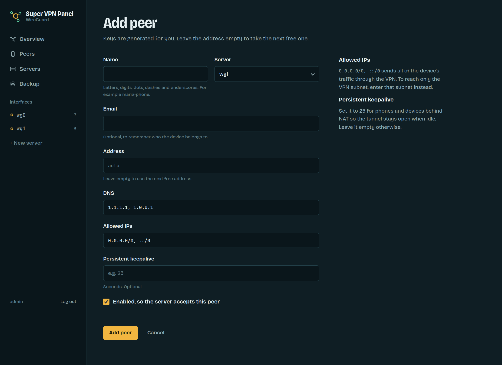
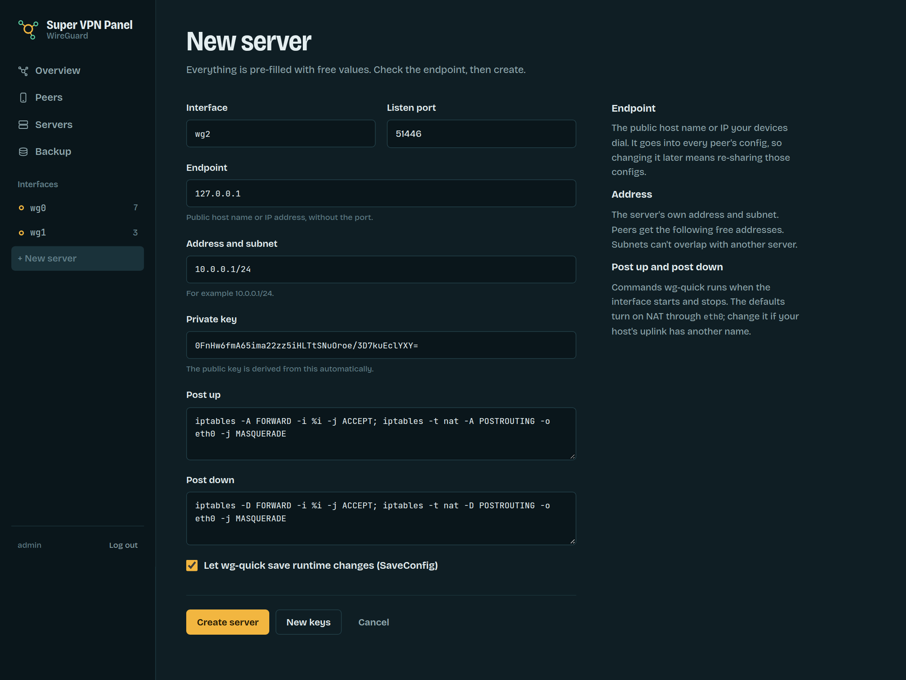
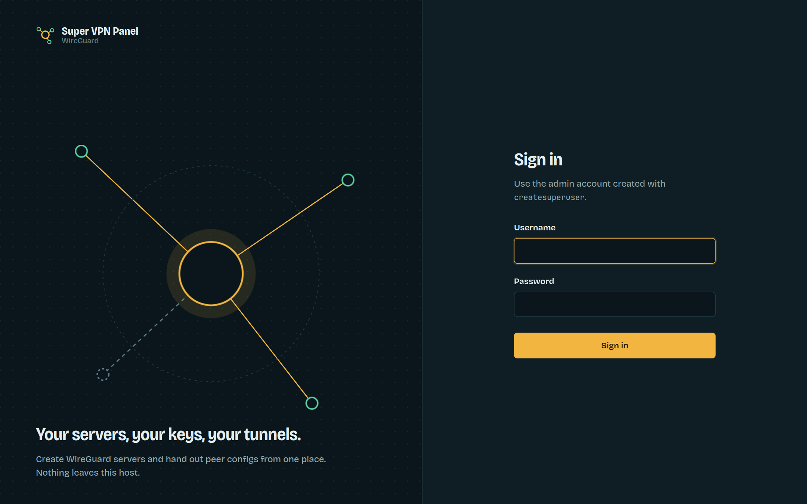
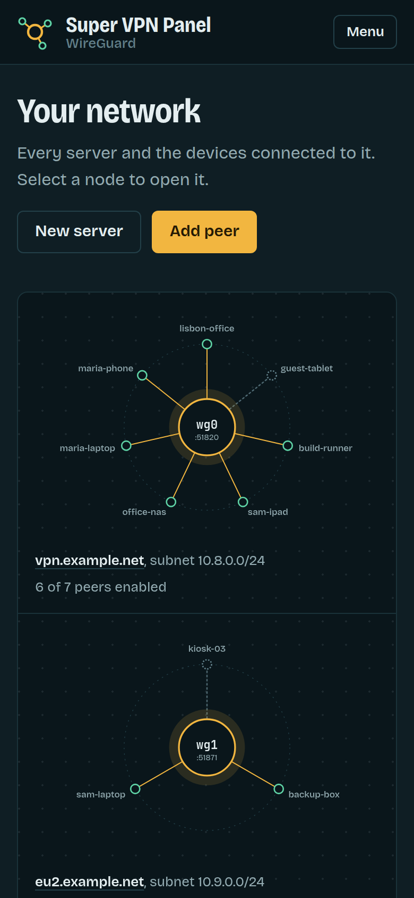

# super-vpn-panel

### A small web panel for managing WireGuard servers and client (peer) configs.

Create a server interface, add peers to it, and the panel generates each peer's keys, picks a free address in the server's subnet, and gives you a ready-to-import `.conf` file and QR code. It also keeps the server's own `<interface>.conf` (with one `[Peer]` block per enabled peer) up to date on disk.

Features:

- Server and peer create / edit / delete, with validation (key format, subnet overlap, duplicate addresses)
- Automatic peer IP allocation
- Enable or disable a peer without deleting it
- Peer `.conf`, QR code and `.tar.gz` profile downloads, all behind login
- Server `.conf` download, written to disk on every change
- JSON backup export and import
- A live map of your servers and peers on the overview page

## How To Usage

Keys and QR codes are generated in Python, so you don't need `wireguard-tools` or `qrencode` on the panel host.

#### Local (virtual environment)

Requires Python 3.10 or newer. On Debian/Ubuntu you may need `sudo apt-get install python3-venv` first.

```
$ python3 -m venv venv
$ source venv/bin/activate          # Windows: venv\Scripts\activate
$ pip install -r requirements.txt
$ export DJANGO_DEBUG=1
$ python manage.py migrate
$ python manage.py createsuperuser
$ python manage.py runserver
```

Then open http://127.0.0.1:8000/ and log in.

Each time you open a new terminal, run `source venv/bin/activate` (and `export DJANGO_DEBUG=1`) again before using `manage.py`. Run `deactivate` to leave the environment.

#### Docker

```
$ docker compose up --build
$ docker compose exec web python manage.py createsuperuser
```

#### Configuration

| Variable | Default | |
|---|---|---|
| `DJANGO_SECRET_KEY` | none | Required unless `DJANGO_DEBUG` is on |
| `DJANGO_DEBUG` | off | `1` for local development |
| `DJANGO_ALLOWED_HOSTS` | `localhost,127.0.0.1` | Comma-separated |
| `DJANGO_DB_PATH` | `db.sqlite3` | SQLite file location |
| `WIREGUARD_SERVER_CONF` | `wireguard/wg-configs/server/conf/` | Where `<interface>.conf` files are written |

To put a server live, copy its generated config to `/etc/wireguard/<interface>.conf` on the VPN host (or point `WIREGUARD_SERVER_CONF` there) and run `wg-quick up <interface>`. After adding or removing peers, reload it with `wg syncconf <interface> <(wg-quick strip <interface>)`.

#### Tests

```
$ DJANGO_DEBUG=1 python manage.py test
```

## Screenshots

The overview maps each server and the peers connected to it. Dashed lines are disabled peers.



| | |
|---|---|
|  |  |
|  |  |
|  |  |



Fonts: [Bricolage Grotesque](https://github.com/ateliertriay/bricolage) and [JetBrains Mono](https://www.jetbrains.com/lp/mono/), both under the SIL Open Font License and bundled in `wireguard/static/vendor/fonts/`, so the panel makes no external requests.
